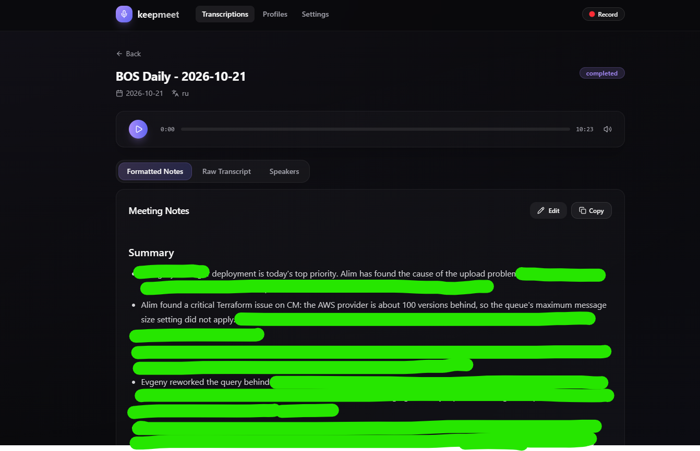
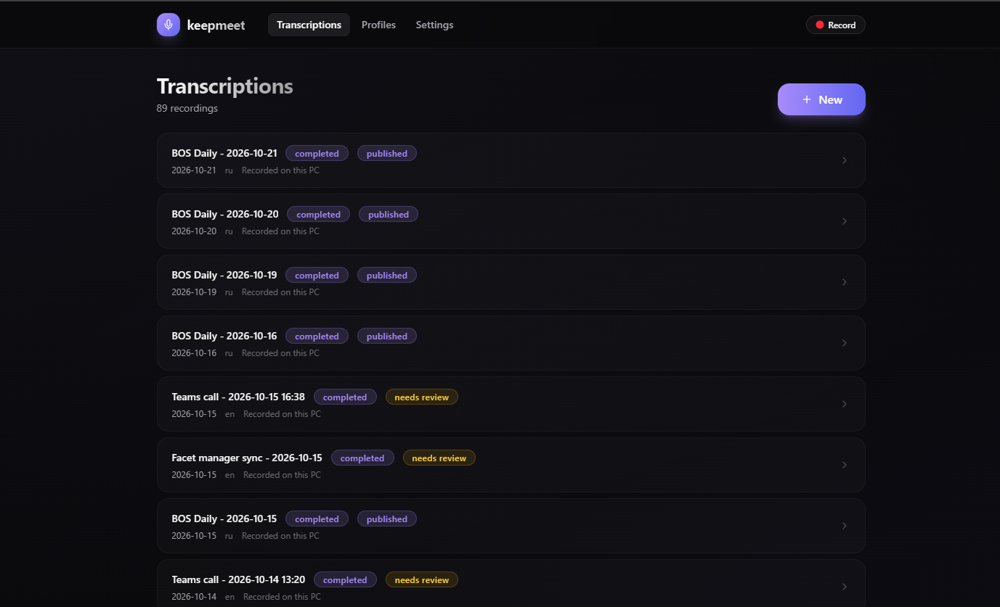
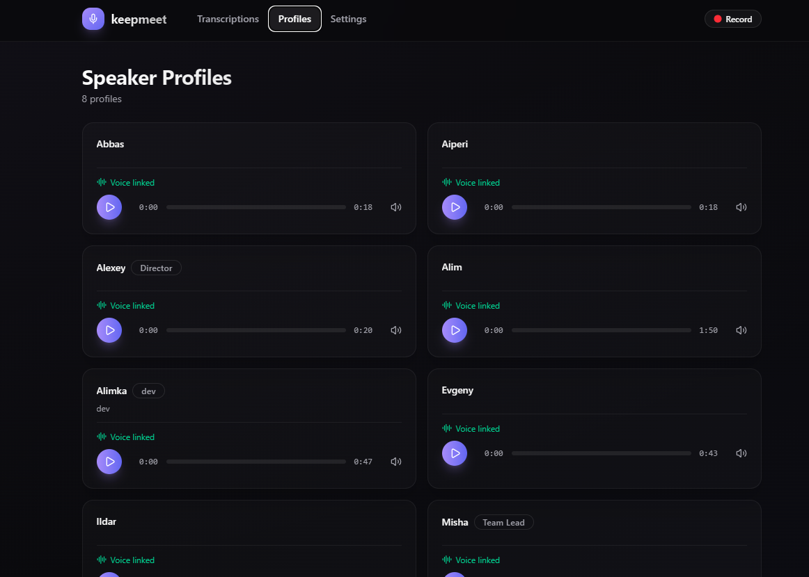
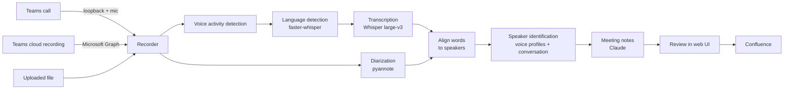
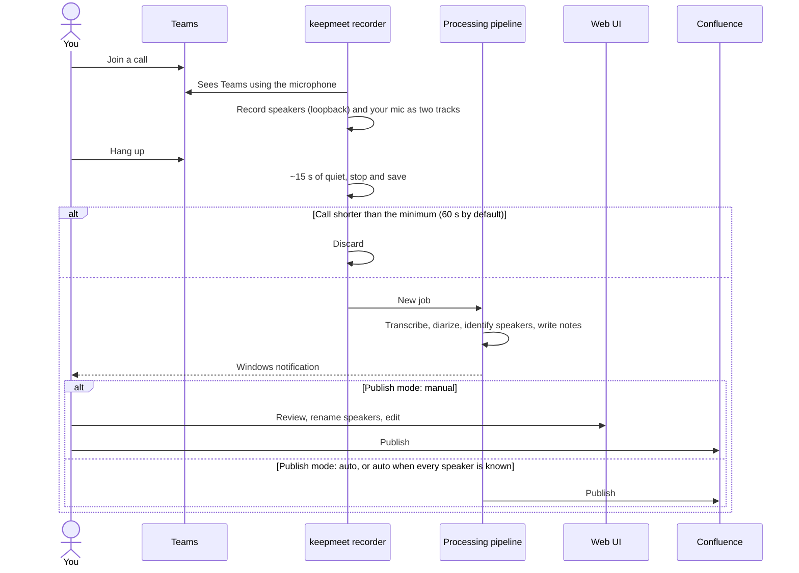
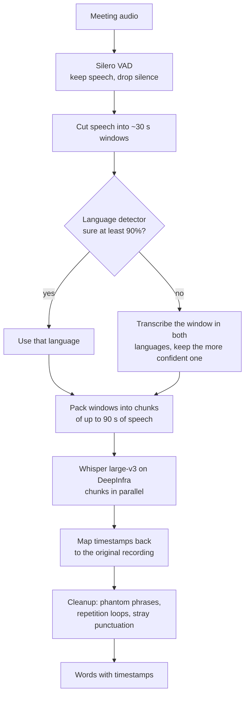
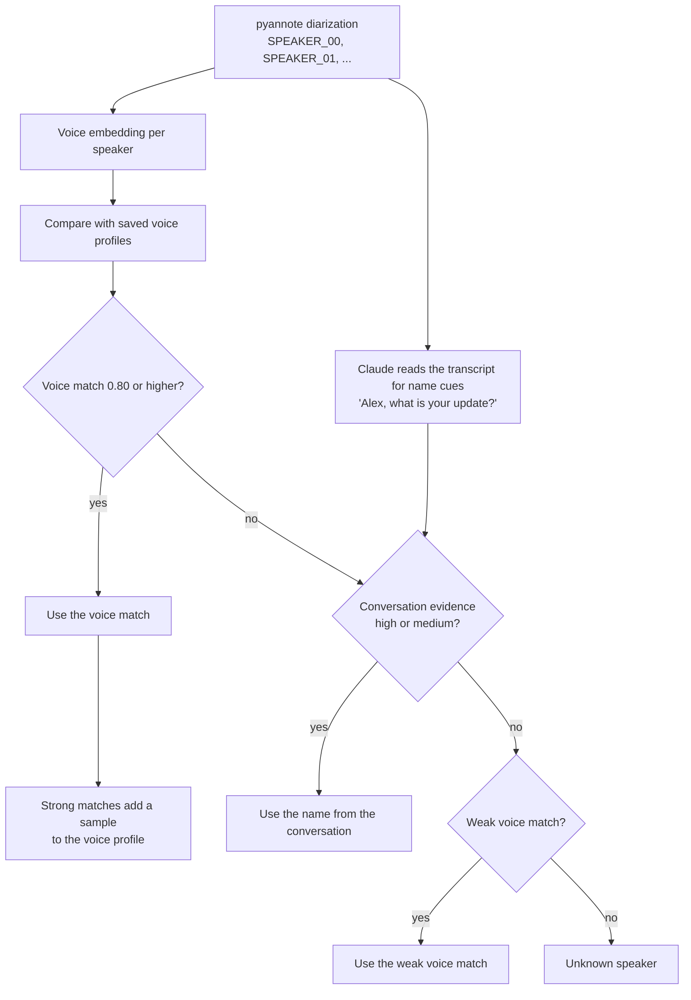
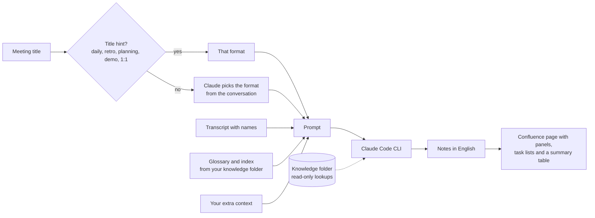

<div align="center">

# 🎙️ keepmeet

**Your meetings, written up while you grab a coffee.**

keepmeet records your Teams calls, figures out who said what, and turns the conversation into clean, structured meeting notes, ready to publish to Confluence.

[](LICENSE)


</div>

<p align="center">
  
</p>

<table>
  <tr>
    <td width="50%"></td>
    <td width="50%"></td>
  </tr>
  <tr>
    <td align="center"><sub>Every call is recorded, processed and tracked until it's published</sub></td>
    <td align="center"><sub>Voice profiles get better with every meeting</sub></td>
  </tr>
</table>

---

## Why keepmeet?

Someone always has to take notes. They miss half the discussion, the notes come out late, and the action items get lost in a chat thread.

keepmeet runs quietly on your PC. When a Teams call starts, it records. When the call ends, it transcribes, recognizes the speakers by voice, and writes notes in the right shape for the meeting: a standup gets per-person updates, a planning session gets a scope table, a design discussion gets options and decisions. You review, click **Publish**, and the page is in Confluence.

## ✨ Features

- **🔴 Hands-free recording.** Detects when you join a Teams call and records the call audio plus your microphone. It stops on its own when the call ends. No bot joins the meeting.
- **☁️ Teams cloud recordings.** Optionally picks up recordings from OneDrive and meeting chats through Microsoft Graph.
- **🌍 Mixed-language transcription.** Whisper large-v3 with per-segment language detection. A meeting can start in Russian and switch to English, and both parts come out right.
- **🗣️ Speaker diarization and voice profiles.** pyannote splits the audio by voice, and saved voice profiles name the speakers. Every confirmed name teaches the profile, so recognition improves with each meeting.
- **🧠 Conversation-aware naming.** When a voice is unknown, Claude reads the transcript for cues like *"Alex, what's your update?"* and fills in the name, showing the evidence it used.
- **📝 Seven note formats.** Daily standup, planning, technical discussion, retrospective, demo/review, 1:1 and general discussion. The format is picked from the title and the conversation, or you choose it.
- **📚 Knows your system.** Point it at a folder with your team's glossary and service index, and misheard service names come out with their official spelling.
- **🧹 Hallucination cleanup.** Voice activity detection skips silence, and a cleanup pass removes Whisper's classic phantom phrases ("Thanks for watching!", fake subtitle credits) and repetition loops.
- **📤 One-click Confluence publishing.** Notes become a proper Confluence page with info panels, task lists and a meeting summary table. Publishing again updates the same page.
- **✏️ Everything editable.** Rename speakers, edit the notes, add context ("SPEAKER_02 is our QA lead") and regenerate.

## 🔧 How it works

### The big picture



### From joining a call to published notes



Your microphone is recorded on its own track, so everything on it is labeled as you without any guessing.

### Transcription that handles mixed languages



Each chunk is transcribed with a short prompt of participant names and your vocabulary, so names and jargon are spelled the way your team spells them.

### Who said what



A name is never given to two speakers unless their voices match too. Each name shows its source and evidence, so you can fix a wrong guess in one click, and saving the names teaches the voice profiles.

### Notes in the right shape



| Stage | Runs on | What it does |
|---|---|---|
| Voice activity detection | Local CPU | Silero VAD finds speech and drops silence, so you only transcribe what was said |
| Language detection | Local GPU | faster-whisper `medium` picks the language of every ~30-second window |
| Transcription | [DeepInfra](https://deepinfra.com) | Whisper large-v3, with your names and vocabulary as a prompt; runs in parallel with diarization |
| Diarization | Local GPU | pyannote 3.1 clusters speech by voice; a 4 GB GPU is enough |
| Speaker identification | Local + Claude | Voice embeddings are matched against saved profiles, then conversation cues fill the gaps |
| Notes | [Claude Code](https://claude.ai/code) CLI | Writes notes in the chosen format, always in English |

## 🚀 Quick start

### Requirements

- Windows 10 or 11 with the Teams desktop app
- Python 3.12 and [uv](https://docs.astral.sh/uv/)
- Node.js 20+
- An NVIDIA GPU is recommended (CPU works, just slower)
- [Claude Code](https://claude.ai/code) installed and signed in (the `claude` command)
- A [DeepInfra](https://deepinfra.com) API key
- A [Hugging Face](https://huggingface.co) token, after accepting the terms of [pyannote/speaker-diarization-3.1](https://huggingface.co/pyannote/speaker-diarization-3.1) and [pyannote/segmentation-3.0](https://huggingface.co/pyannote/segmentation-3.0)

### Install

```powershell
git clone https://github.com/alim-tg/keepmeet.git
cd keepmeet

uv sync
uv pip install --reinstall torch==2.10.0 torchaudio==2.10.0 --index-url https://download.pytorch.org/whl/cu128

cd frontend; npm install; cd ..

copy .env.example .env
copy config.yaml.example config.yaml
```

Fill in `.env`:

```ini
HF_TOKEN=hf_...
DEEPINFRA_API_KEY=...
```

> [!TIP]
> Skip the `torch` reinstall if you have no NVIDIA GPU. If you add packages later with `uv add`, run the reinstall again, because uv swaps the CUDA build for the CPU one.

### Run

```powershell
.venv\Scripts\keepmeet check      # verify keys, GPU and the claude CLI
.venv\Scripts\keepmeet shortcut   # create a desktop icon
.venv\Scripts\keepmeet app        # start it now
```

keepmeet opens at **http://localhost:6070**. The web UI is built automatically on first start. Closing the keepmeet window stops it.

Then open **Settings**:

1. Enter **Your name**, so your own microphone track is labeled as you.
2. Turn on **Record from this PC**.
3. Optionally connect Confluence, add a knowledge folder and add vocabulary.

Join a call, and the notes show up a few minutes after you hang up.

## 📝 Note formats

| Format | Picked for | Sections after the summary |
|---|---|---|
| **Daily standup** | "Daily", "Standup" | Decisions · Action items · Blockers · per-person Yesterday / Today |
| **Planning** | "Planning", "Grooming", "Refinement" | Goals · Committed scope table · Deferred · Risks & dependencies |
| **Technical discussion** | Design and architecture talks | Context · Options with pros and cons · Decisions with reasoning · Affected systems · Risks |
| **Retrospective** | "Retro" | What went well · What to improve · Ideas to try · Action items |
| **Demo / review** | "Demo", "Review" | What was shown and the feedback · Follow-ups |
| **1:1** | "1:1", "One-on-one" | Topics · Feedback · Agreements |
| **General discussion** | Anything else | Discussion by topic · Decisions · Action items |

When the title gives no hint, Claude picks the format from the conversation. You can override it per meeting and regenerate.

## 📚 System knowledge

Speech recognition mangles internal names: "Billing Service" comes out as "biling servis", and acronyms get split into letters. Give keepmeet a folder with your team's docs:

```
team-docs/
├── glossary.md   # | **BLS** | Billing Service — invoices and payments |
└── index.md      # one line per service or repo
```

`glossary.md` and `index.md` can sit at the folder root, in `memory/` or in `docs/`. Both go into every notes prompt, and glossary terms are suggested as transcription vocabulary.

With **Deep lookups** on, Claude may also read other files in that folder, read-only (Read, Grep and Glob only), when a meeting goes deep on one service.

## 🔐 Privacy

keepmeet is a local app. Recordings, transcripts, voice profiles and settings stay in `data/` on your PC.

What leaves your machine:

| Service | What is sent |
|---|---|
| DeepInfra | Speech segments of the audio, for transcription |
| Anthropic, through Claude Code | The transcript, for speaker naming and notes |
| Confluence | The notes, only when you publish |
| Hugging Face | Nothing; it only serves the model downloads |

The Confluence token is encrypted with Windows DPAPI and only works for your Windows account.

> [!IMPORTANT]
> Recording a call from your PC shows no recording banner to the other participants. Always tell people you are recording, and follow the laws and company policies that apply to you.

## ⚙️ Configuration

| Where | What |
|---|---|
| `.env` | Secrets: `HF_TOKEN`, `DEEPINFRA_API_KEY`, and optionally `CONFLUENCE_*` and `GRAPH_*` |
| `config.yaml` | Base settings; see `config.yaml.example` |
| Settings page | Everything else: recording, transcription languages and vocabulary, knowledge folder, Confluence target, Teams cloud sources, publish mode |

Teams cloud recordings need a small Entra app registration. See [docs/teams-setup.md](docs/teams-setup.md).

## 🗂️ Project layout

```
src/keepmeet/
├── asr/                  # transcription pipeline: VAD, chunking, language, DeepInfra, diarization, alignment, cleanup
├── server/               # FastAPI app, job runner, Teams watcher, local recorder
├── speaker_profiles.py   # voice embeddings and profile matching
├── speaker_id.py         # combines voice matches and conversation cues
├── note_formats.py       # the seven meeting formats
├── knowledge.py          # loads the glossary and index
├── formatter.py          # notes prompt and the Claude call
├── publisher.py          # Markdown to Confluence storage format
└── recorder.py           # WASAPI loopback and microphone capture
frontend/                 # React 19 + Vite + Tailwind web UI
tests/                    # pytest suite
```

## 🛠️ Development

```powershell
.venv\Scripts\python -m pytest            # backend tests
cd frontend; npx tsc -b; npx eslint src   # frontend checks
npm run dev                               # UI dev server on :5670, proxies the API on :6070
```

## ⚠️ Limitations

- Windows only: recording uses WASAPI loopback and secrets use DPAPI.
- Teams in the browser isn't detected. Use the desktop app or **Record now**.
- Teams must play through the Windows default output device.
- When diarization merges two similar voices into one cluster, that cluster gets a single name.
- Transcription language detection is tuned for a small set of languages (Russian and English by default; configurable).

## 📄 License

[MIT](LICENSE)
